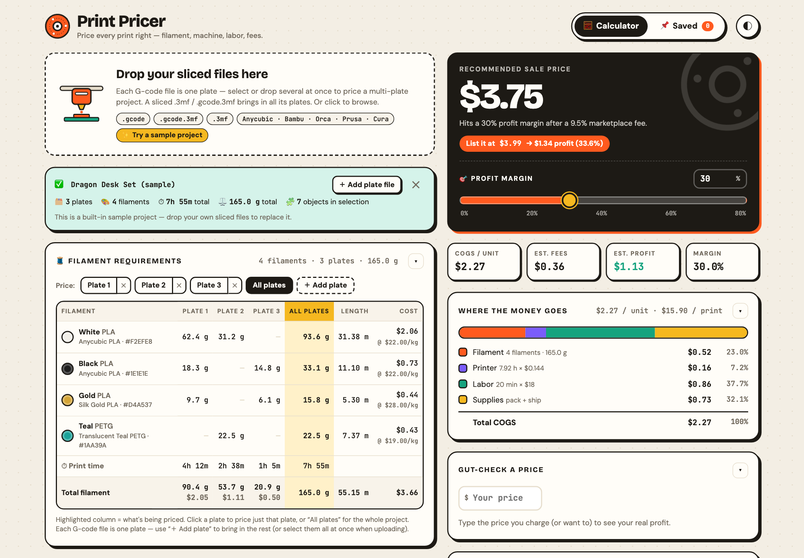
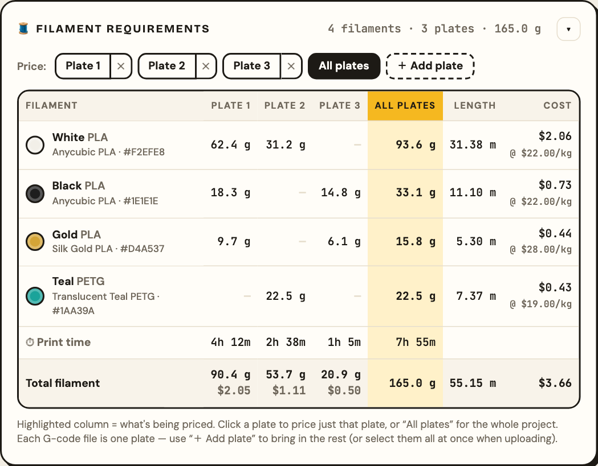
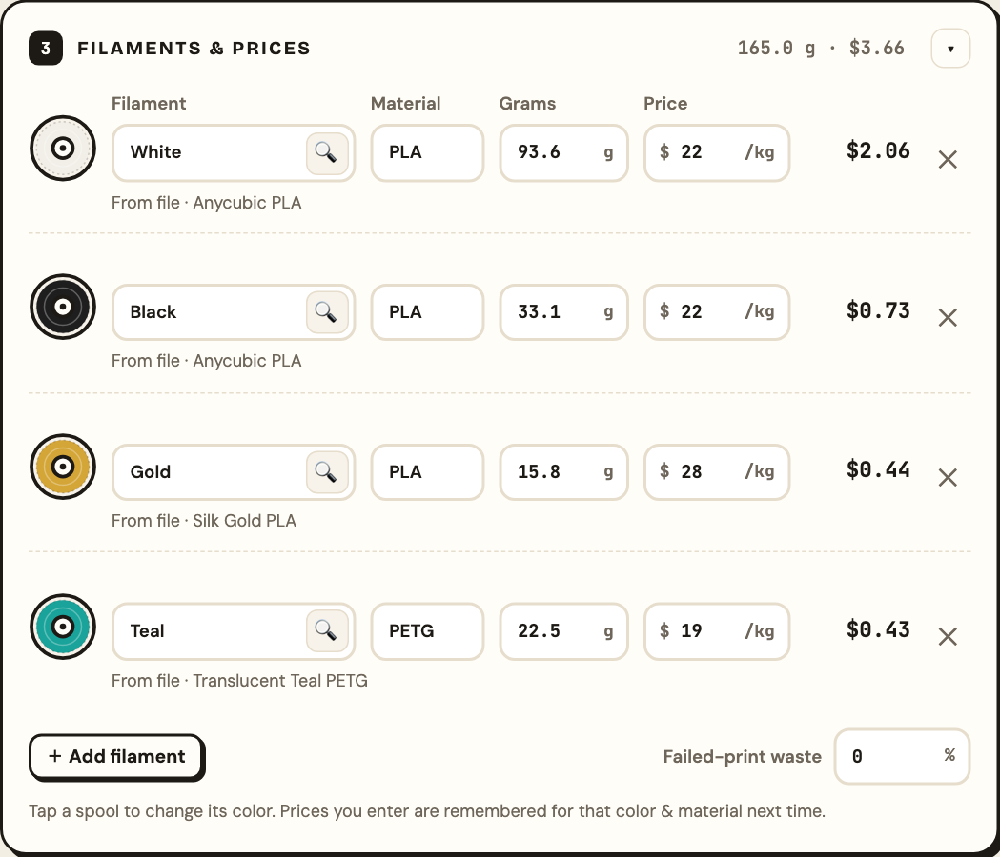
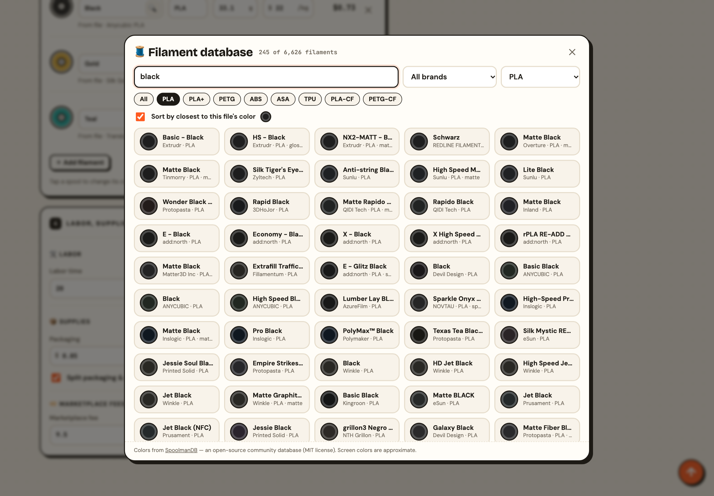
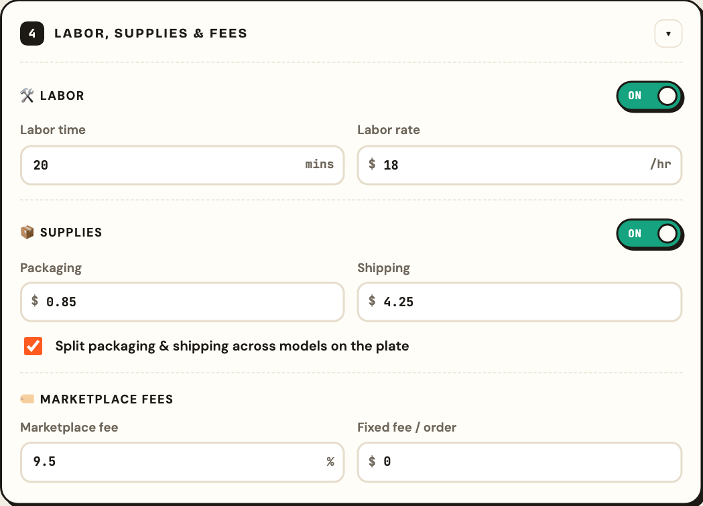
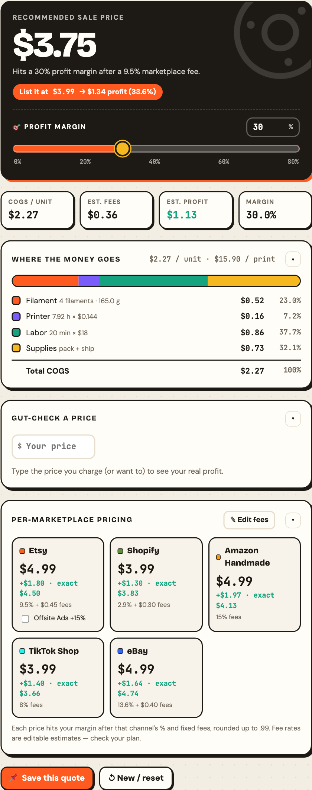
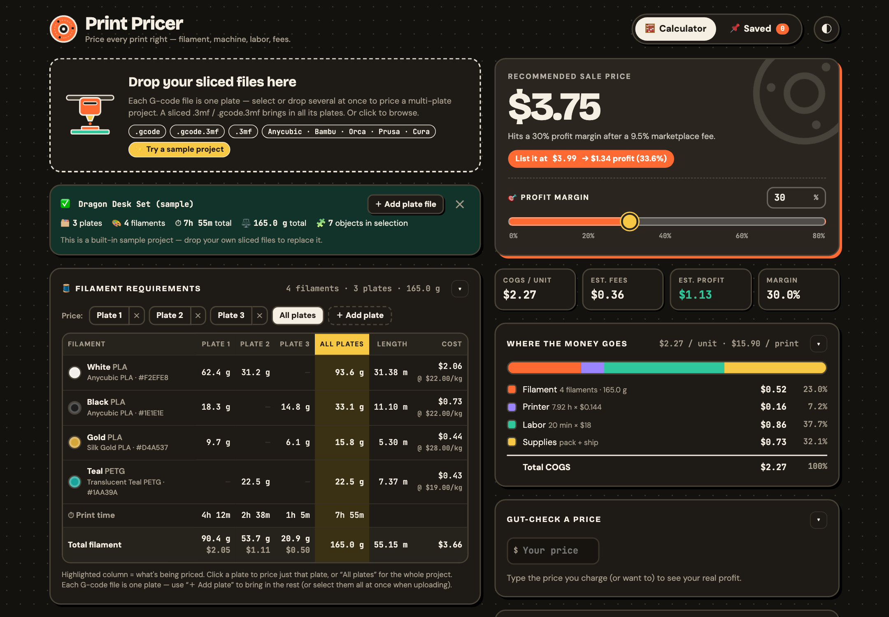
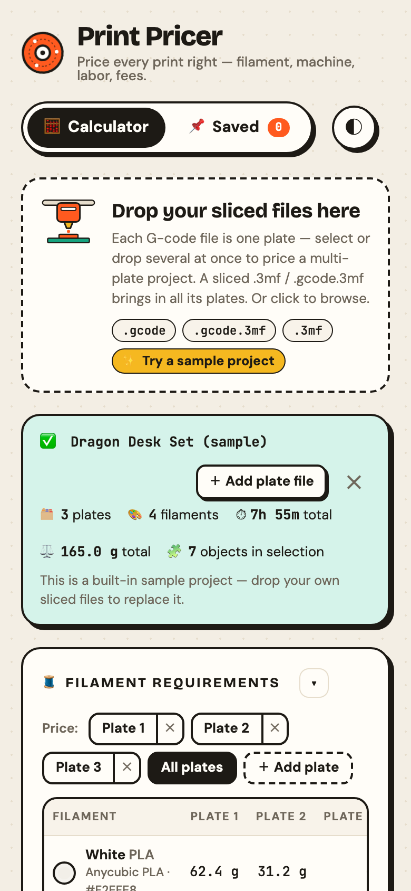

<div align="center">

# 🧮 Print Pricer

**Price every 3D print right — filament, machine time, labor, supplies and marketplace fees.**

Drop in your sliced G-code or 3MF and get a recommended sale price in seconds.<br>
Free, no sign-up, and your files never leave your computer.

### [▶ Open Print Pricer](https://austinmaster167.github.io/print-pricer/) &nbsp;·&nbsp; [✨ Try the sample project](https://austinmaster167.github.io/print-pricer/?sample)

<br>



</div>

---

## ✨ What it does

| | |
|---|---|
| 📂 **Reads your slicer files** | Drag in `.gcode`, `.gcode.3mf` or `.3mf` — print time, grams and color for every filament are filled in automatically. |
| 🗂 **Multi-plate projects** | Each G-code file is one plate. Drop several at once (or add them one by one) to price a whole project, or price any single plate. |
| 🎨 **Per-color filament pricing** | Set a $/kg for every color. Prices are remembered for that color & material next time. |
| 🔍 **Filament database** | Pick from **6,600+ real filaments from 87 brands** (Anycubic, Bambu Lab, Elegoo, eSun, Polymaker, Sunlu, Prusament…). |
| 🖨 **Printer costs** | Electricity, depreciation and maintenance per hour. Presets included (Anycubic Kobra X, Bambu, Prusa, Creality, Elegoo) or save your own. |
| 🎯 **Margin slider** | Drag to your target profit margin and watch the price update instantly. |
| 🔘 **Turn costs on/off** | Leave printer, labor or supplies out of the price with one switch. |
| 🏷 **Marketplace pricing** | Prices for Etsy (with optional Offsite Ads), Shopify, Amazon Handmade, TikTok Shop and eBay — each with its own fees. |
| 🧾 **Gut-check & save** | Type the price you actually charge to see your real profit, and save quotes for later. |
| 🌗 **Light & dark mode** | Works on desktop and phone. |

---

## 🧵 See exactly how much filament you need

Every filament in the project, broken down **per plate**, with length, $/kg and cost. Click a plate to price just that plate, or **All plates** for the whole project.



Each filament row can be renamed, recolored, or picked from the database with the 🔍 button — then just type what you pay per kg.



## 🔍 Filament database

Search by brand, color or material (try *“anycubic black”* or *“silk gold”*). Filaments that came from your file can be sorted by the **closest color match**.



## 💸 Pricing, margins & marketplaces

<table>
<tr>
<td width="50%" valign="top">

The price panel shows the recommended price, a “.99” charm price, cost of goods per unit, fees, profit and margin — plus a breakdown of where the money goes and per-marketplace prices.

Labor, supplies and printer costs each have an **ON / OFF** switch, and every section folds closed by tapping its header.



</td>
<td width="50%" valign="top">



</td>
</tr>
</table>

## 🌗 Dark mode & mobile

<table>
<tr>
<td width="72%"></td>
<td width="28%"></td>
</tr>
</table>

---

## 🚀 How to use it

1. **Slice your model** in Anycubic Slicer Next, Bambu Studio, OrcaSlicer, PrusaSlicer or Cura.
2. **Export the G-code** (one file per plate) or save the sliced project as a `.3mf` / `.gcode.3mf`.
3. **Drop the file(s)** onto [Print Pricer](https://austinmaster167.github.io/print-pricer/).
   - Multiple plates? Select all the G-code files at once, or use **＋ Add plate**.
4. **Set your filament prices** ($/kg) — or pick each spool from the 🔍 database.
5. **Check labor, supplies and fees**, slide the margin to taste, and read off your price.

### Supported files

| File | What's read |
|---|---|
| `.gcode` | Print time, grams per filament, colors, materials, object count — Anycubic, Bambu, Orca, Prusa, Cura, Simplify3D. |
| `.gcode.3mf` / sliced `.3mf` | Every plate with its own time and per-color grams. |
| Unsliced `.3mf` | A rough filament estimate from the model's volume (slice it for exact numbers). |
| `.bgcode` | Not supported — turn off *Binary G-code* in your slicer and export again. |

---

## 🧮 How the math works

```text
Filament   = Σ (grams × $/kg ÷ 1000) × (1 + failed-print waste %)
Printer    = print hours × (electricity $/hr + printer price ÷ lifetime hours + maintenance $/hr)
Labor      = labor minutes ÷ 60 × labor $/hr
Supplies   = packaging + shipping

Cost per unit (COGS) = (filament + printer + labor) ÷ models  +  supplies (÷ models if split)

Recommended price = (COGS + fixed fee) ÷ (1 − marketplace fee % − profit margin %)
Profit            = price − COGS − (price × fee % + fixed fee)
```

Marketplace cards use the same formula with each channel's own fee % and fixed fee (editable — check your plan's current rates).

---

## 🔒 Privacy

Everything runs in your browser. Your G-code and 3MF files are **read locally and never uploaded**. Prices, printers and saved quotes are stored only in your own browser's local storage — nobody else (including the site owner) can see them.

## 🛠 Run it yourself

It's a single static page — no build step, no server code.

```bash
git clone https://github.com/AustinMaster167/print-pricer.git
cd print-pricer
python3 -m http.server 8000   # then open http://localhost:8000
```

You can also just double-click `index.html`. (The filament database loads from the live site when opened as a local file.)

## 🙏 Credits

Filament colors come from **[SpoolmanDB](https://github.com/Donkie/SpoolmanDB)** — an open-source community filament database, © 2024 Donkie, MIT License. Colors on screen are approximate.
